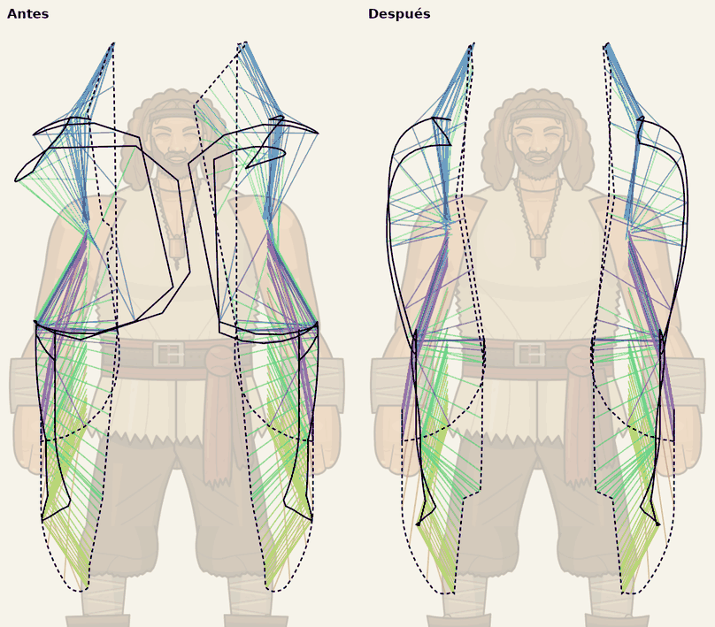
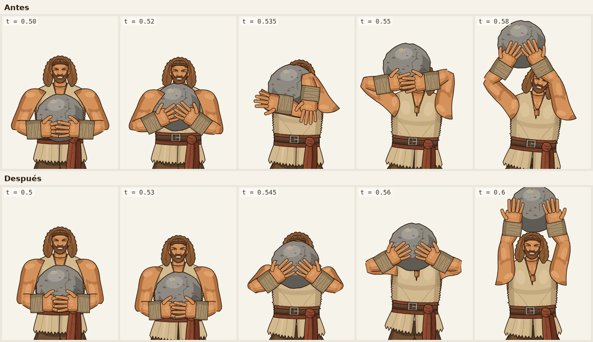

# Estudio · brazos al levantar la roca

Análisis del movimiento de húmero y antebrazo en `liftRock` (vista frontal y de espalda) y de los cambios que lo hacen natural.

## 1. Diagnóstico

Al subir la roca por delante de la cara (t ≈ 0,51–0,55) y al bajarla (t ≈ 0,78–0,82), cada brazo daba una vuelta: el codo pasaba de estar abajo a estar arriba cruzando por dentro del pecho y de la cara.

Medido en la animación original (muestreo de 440 fotogramas):

| | Antes | Después |
| --- | --- | --- |
| Giro máximo del húmero | 4547 °/s (t = 0,536) | 923 °/s |
| Giro máximo del antebrazo | 7033 °/s (t = 0,536) | 658 °/s |
| Codo dentro del torso | t = 0,53 … 0,81 | nunca |

**Causa.** El IK era plano y con huesos rígidos (húmero 111 u, antebrazo 87 u). La roca (168 u de ancho) es más estrecha que los hombros (194 u), así que, cuando pasa por delante de la cara, las manos quedan a la altura del hombro y unas 30–40 u hacia dentro: la distancia hombro–mano en el plano cae a unas 50 u. Con huesos rígidos el brazo tiene que plegarse del todo y el codo se aleja casi 100 u de esa línea. El solver elegía el lado del codo "hacia fuera" comparando dos coordenadas x casi iguales, de modo que, al cruzar la mano la horizontal del hombro, el codo saltaba de un lado al otro (175° en un fotograma) y el antebrazo daba la vuelta detrás.

**Qué pasa en la realidad.** El codo no da la vuelta: avanza hacia el espectador. Visto de frente, el húmero apunta a cámara y se ve más corto (escorzo). Un IK plano con huesos rígidos no puede dibujar eso; por eso inventaba circunferencias.

## 2. Biomecánica de referencia

Levantar una piedra redonda hasta encima de la cabeza (piedra al pecho y press con impulso de piernas):

| Fase | t | Qué hace el cuerpo | Qué hacen los brazos |
| --- | --- | --- | --- |
| Agarre | 0,10–0,20 | sentadilla profunda, pies abiertos | brazos casi rectos, manos a los lados de la roca, codos fuera y atrás |
| Despegue | 0,20–0,28 | la cadera sube un poco | brazos rectos: tiran las piernas y la espalda |
| Al regazo | 0,28–0,38 | se sienta con la roca sobre los muslos | brazos rodeando la roca |
| Reagarre | 0,38–0,42 | sigue sentado | **el húmero se abre**: codos fuera mientras las manos se meten bajo la roca |
| De pie | 0,42–0,50 | extiende cadera y rodillas; la roca rueda por el tronco | **sube el antebrazo**, luego **el húmero se cierra**: codos abajo, antebrazos bajo la roca (*rack*) |
| Flexión | 0,50–0,53 | baja la cadera unas 24 u con la roca apoyada en el pecho | brazos quietos en el rack |
| Empuje | 0,53–0,60 | extensión explosiva de piernas, recogida corta | **el húmero se vuelve a abrir** (codos fuera, a la altura del hombro) **a la vez que sube el antebrazo**; la roca pasa por delante de la cara |
| Bloqueo | 0,60–0,66 | se pone de pie | extensión completa, codos un poco fuera |
| Bajada | 0,76–0,84 | rodillas amortiguan | el mismo camino al revés, más despacio: codos fuera, la roca pasa por delante de la cara, rack |
| Soltar | 0,875–0,91 | | los brazos se abren y vuelven al costado; la roca cae |

Reglas que salen de ahí: la fuerza viene de las piernas, los brazos guían; mientras empujan, los codos van por fuera y por debajo de las manos; húmero y antebrazo no giran a la vez en sentidos opuestos, se relevan.

## 3. Solución

### 3.1 IK 3D con polo y escorzo

Cada clave de IK puede llevar, además de `x, y` (y `w`), la profundidad de la mano `z` (+ hacia el espectador) y un polo `px, py, pz` (hacia dónde apunta el codo). Con esos datos el motor resuelve la cadena de dos huesos en 3D: el codo está en el círculo de puntos a 111 u del hombro y a 87 u de la mano, y se elige el punto de ese círculo que mira hacia el polo. Después proyecta: los ángulos 2D salen de la proyección y la longitud proyectada de cada hueso se aplica como escorzo, una escala del dibujo a lo largo de su eje (canal `k`, sin adelgazarlo).

- El codo no puede saltar: el polo decide su lado de forma continua.
- Cuando el húmero apunta al frente se ve más corto en vez de dar la vuelta.
- Las claves sin `z` ni polo siguen usando el IK plano (piernas, saludo), así que nada más cambia.

### 3.2 Claves de cada brazo

Mano izquierda respecto al centro de la roca (la derecha es su reflejo):

| t | Fase | Mano (x, y) | z | Polo | Húmero / antebrazo |
| --- | --- | --- | --- | --- | --- |
| 0,14 | agarre | 92, −26 | 20 | fuera, atrás | casi recto |
| 0,38 | regazo | 80, 0 | 44 | fuera, atrás | rodea la roca |
| 0,42 | reagarre | 62, 36 | 40 | fuera | se abre |
| 0,46 | de pie | 60, 46 | 48 | fuera, abajo | sube el antebrazo |
| 0,50 | rack | 58, 50 | 45 | abajo | se cierra |
| 0,555 | empuje | 82, 40 | 120 | fuera, algo al frente | se abre a la altura del hombro, antebrazo hacia arriba y adentro |
| 0,60 | empuje | 74, 44 | 60 | fuera | sube |
| 0,66 | bloqueo | 72, 44 | 16 | fuera | extendido |
| 0,80 | bajada | 82, 40 | 120 | fuera, algo al frente | igual que el empuje |
| 0,84 | rack | 58, 50 | 45 | abajo | se cierra |

Con estas claves el húmero barre siempre por fuera (de 72° a 0° y a −81°, pasando por la horizontal) y el antebrazo sube de forma continua.

### 3.3 Cuerpo

- Impulso de piernas real: flexión (pelvis +24 en t = 0,53), empuje (pelvis −4 en t = 0,565, la roca sale lanzada), recogida (+12 en t = 0,6) y bloqueo de pie en t = 0,66.
- En la bajada, las rodillas amortiguan (+8 y +12).
- La pose clave «Impulso» de la hoja pasa a t = 0,56.

## 4. Límite conocido

Durante unos 0,3 s del empuje el húmero llega a verse al 48 % de su longitud. Es inevitable con estas proporciones: cuando la roca pasa por delante de la cara el húmero apunta a cámara. Abrir más el agarre ya no ayuda, porque la mano tiene que seguir tocando la roca.

## 5. Vista de espalda

`liftRock` lleva una pista de capas: entre t = 0,105 y 0,895 los dos brazos están en estado `fore` (trabajan delante del cuerpo). De frente no cambia nada; de espaldas, brazos y manos pasan detrás de la espalda y de la cabeza. La roca, el polvo y el fajín, que van delante del cuerpo, se dibujan siempre detrás en esa vista.
